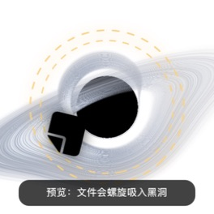

# Black Hole Bin

[简体中文](README.zh-CN.md)

A native macOS trash target rendered as a gravitationally lensed black hole.
Drag a Finder item over it to wake the accretion disk, then release to spiral
the item into the event horizon and move it to the system Trash.



> **Project status:** early preview. The source is ready for contributors, but
> public binary releases still need Developer ID signing and Apple notarization.

## Highlights

- Native AppKit menu-bar utility with a transparent, borderless floating panel
- WebGL2 geodesic ray tracing adapted from
  [`s0xDk/ghostty-blackhole`](https://github.com/s0xDk/ghostty-blackhole)
- Responsive hover, gravity-ring and multi-file spiral suction animations
- Finder files and folders are moved with `NSWorkspace.recycle`
- One-batch undo from the menu bar or the black hole context menu
- Position memory, all-Spaces visibility, always-on-top and reduced-motion modes
- No network requests, analytics, privileged helper or permanent-delete API

## Safety model

Black Hole Bin never permanently deletes an item. A successful drop calls the
macOS recycle API, so Finder remains responsible for Trash storage and final
deletion. The app keeps only the most recent recycle result in memory for undo.

As with any file-management utility, test a source build with disposable files
before using it with important data.

## Requirements

- Runtime: macOS 13 or newer
- Build: Swift 6 toolchain (Xcode 16 or a compatible Command Line Tools install)
- Rendering: WebGL2 support in `WKWebView`

## Build and run

No third-party packages are required.

```sh
swift build -c release
.build/release/BlackHoleBin --self-test
./Scripts/build-app.sh
open "dist/黑洞垃圾箱.app"
```

`build-app.sh` creates an ad-hoc-signed, current-architecture app bundle at
`dist/黑洞垃圾箱.app`. It is intended for local development, not public binary
distribution.

## Use

1. Launch the app. The black hole appears near the lower-right of the main display.
2. Move the pointer over it to preview the gravity response.
3. Drag files or folders from Finder onto it and release.
4. Use **Undo Last Drop** from the menu-bar item or right-click menu if needed.
5. Drag the black hole itself to reposition it. The position is remembered.

Double-clicking the black hole runs a harmless suction preview.

## Architecture

| Component | Responsibility |
| --- | --- |
| `BlackHolePanel` | Transparent non-activating panel and position persistence |
| `BlackHoleView` | Pointer/drag state, native overlays and icon animation |
| `BlackHoleWebRenderer` | Local `WKWebView` bridge and WebGL2 lifecycle |
| `blackhole.glsl` | Geodesic tracing, accretion disk and interaction uniforms |
| `TrashController` | Recycle and one-batch undo |

The app uses both AppKit drag callbacks and a system drag-pasteboard fallback.
This handles Finder sources that expose different drag-operation masks while
preventing duplicate recycle operations.

## Upstream and attribution

The renderer is a modified copy of the MIT-licensed
[`s0xDk/ghostty-blackhole`](https://github.com/s0xDk/ghostty-blackhole) shader,
reviewed at commit
[`b49fa0a`](https://github.com/s0xDk/ghostty-blackhole/commit/b49fa0ab2eaf0644a690f4cb386d70c21eb9f969).
This project adds a desktop-bin mode, transparent output, interaction uniforms
and success/error feedback while preserving the upstream geodesic and disk
design.

This repository is an independent derivative project and is not an official
part of Ghostty Blackhole. See [THIRD_PARTY_NOTICES.md](THIRD_PARTY_NOTICES.md)
and [Licenses](Licenses/) for complete attribution.

## Contributing

See [CONTRIBUTING.md](CONTRIBUTING.md). Bug reports should include the macOS
version, Mac model, source application used for the drag and whether the hover
and release phases both appeared.

## License

Black Hole Bin is released under the [MIT License](LICENSE). The upstream
shader retains its original MIT copyright and license notice.
