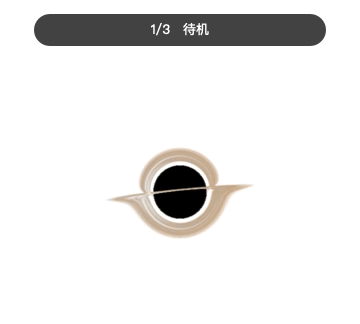

# Black Hole Bin

[](https://github.com/ljunnan24-hash/black-hole-bin/actions/workflows/ci.yml)
[](https://github.com/ljunnan24-hash/black-hole-bin)
[](Package.swift)
[](LICENSE)

[简体中文](README.zh-CN.md)

Drag a file or folder from Finder onto a gravitationally lensed black hole.
Release it to spiral the item into the event horizon and safely move it to the
macOS Trash.

<p align="center">
  
</p>

The recording shows the real three-state flow: idle → file hover → release,
suction and confirmed move to Trash. It uses one disposable text file.

> **Current status: 0.1 preview for macOS only.** You can install from source
> today. A signed and notarized download for non-developers is not available
> yet; this project will not distribute an untrusted prebuilt app in its place.

## Install

### One-command local source install

You need macOS 13 or newer and Swift 6 from Xcode 16 or compatible Command Line
Tools. If `swift` is not available in Terminal, run `xcode-select --install`
first and follow the macOS prompt.

```sh
git clone https://github.com/ljunnan24-hash/black-hole-bin.git
cd black-hole-bin
./Scripts/install-local.sh
```

The script runs the release build, self-test and signature verification, then
installs and opens `~/Applications/黑洞垃圾箱.app`. It needs no third-party
packages or administrator access. To update, quit the running app and run:

```sh
git pull --ff-only
./Scripts/install-local.sh
```

The previous local install is moved to Trash instead of being permanently
deleted. For development or a temporary run:

```sh
./Scripts/check.sh
./Scripts/build-app.sh
open "dist/黑洞垃圾箱.app"
```

To uninstall, quit the app, run `open "$HOME/Applications"` and move
`黑洞垃圾箱.app` to Trash in Finder. This keeps removal visible and recoverable.

> Source builds are ad-hoc signed for the current Mac. Do not download binaries
> from third-party sites or disable Gatekeeper/remove quarantine attributes to
> make one run. The official signed build will appear on this repository's
> [Releases](https://github.com/ljunnan24-hash/black-hole-bin/releases) page.

## Use

1. Launching the app does not open a conventional window. A floating black hole
   appears near the lower-right of the main display, with controls in the menu bar.
2. Drag a file or folder from **Finder** onto the black hole. Gravity rings and
   a release hint appear when the item is over a valid drop area.
3. Release over the black hole. The icon is pulled in, then the original item
   moves to the system Trash.
4. To restore it, immediately choose **Undo Last Drop** from the menu-bar item
   or the black hole's right-click menu.
5. Drag the black hole itself to reposition it; the app remembers the location.

Double-clicking the black hole plays the harmless preview shown above and moves
no files. Pointer hover is intentionally subtle; the complete suction effect
starts after a valid file drop or double-click preview.

## Safety model

- Successful drops call `NSWorkspace.recycle`; there is no permanent-delete path.
- Only the latest successful batch is retained in memory for undo. That undo
  record disappears when the app exits.
- The app does not request Full Disk Access or install a privileged helper.
- There are no network requests, accounts, analytics or cloud rendering.
- The renderer loads only bundled local HTML and GLSL.

File tools still deserve care. Start with one disposable local file and verify
both recycle and undo before using the app with important data. Finder remains
responsible for final Trash deletion.

## Highlights

- Native AppKit menu-bar utility and transparent borderless floating panel
- WebGL2 geodesic ray tracing, accretion disk and gravitational lensing
- Hover, gravity-ring, staggered multi-file suction and status animations
- File/folder recycle with one-batch undo
- All-Spaces visibility, always-on-top, position memory and reduced motion
- No third-party runtime dependencies

## Windows

A Windows version is planned for exploration, with no release date yet. The
current app depends on AppKit, `WKWebView` and `NSWorkspace.recycle`, so it
cannot be compiled directly for Windows. The intended direction is to preserve
the WebGL visual and interaction states while adding a native Windows desktop
shell, WebView2 and the Windows Recycle Bin API—without weakening the
no-permanent-delete and undo guarantees. See [ROADMAP.md](ROADMAP.md).

Contributors with WinUI, WebView2, Windows Shell or cross-platform desktop
experience are welcome to help shape the design before implementation begins.

## Architecture

| Component | Responsibility |
| --- | --- |
| `BlackHolePanel` | Transparent non-activating panel and position persistence |
| `BlackHoleView` | Pointer/drag state, native overlays and icon animation |
| `BlackHoleWebRenderer` | Local `WKWebView` bridge and WebGL2 lifecycle |
| `blackhole.glsl` | Geodesic tracing, accretion disk and interaction uniforms |
| `TrashController` | Recycle and one-batch undo |

The app combines AppKit drag callbacks with a system drag-pasteboard fallback.
This supports Finder sources that expose different drag-operation masks while
preventing duplicate recycle operations.

## Upstream and license

The renderer is adapted from the MIT-licensed
[`s0xDk/ghostty-blackhole`](https://github.com/s0xDk/ghostty-blackhole) shader,
reviewed at commit
[`b49fa0a`](https://github.com/s0xDk/ghostty-blackhole/commit/b49fa0ab2eaf0644a690f4cb386d70c21eb9f969).
This project adds transparent desktop output, interaction uniforms, drag/drop
and success/error feedback. It is an independent derivative project, not an
official part of Ghostty Blackhole.

Black Hole Bin is released under the [MIT License](LICENSE). See
[THIRD_PARTY_NOTICES.md](THIRD_PARTY_NOTICES.md) and [Licenses](Licenses/) for
complete upstream attribution.

## Contributing

Read [CONTRIBUTING.md](CONTRIBUTING.md) and [ROADMAP.md](ROADMAP.md) first.
Drag/drop reports should include the macOS version, Mac model, source
application and whether both hover and release phases appeared. Report
security issues privately as described in [SECURITY.md](SECURITY.md).
