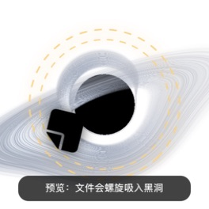

# 黑洞垃圾箱

[English](README.md)

一个原生 macOS 黑洞垃圾箱。把 Finder 中的文件或文件夹拖到黑洞上，黑洞会显示
引力响应；松手后，文件图标沿螺旋轨迹被吸入事件视界，随后安全地移入系统废纸篓。



> **项目状态：** 早期预览版。源码已按开源协作整理；公开分发二进制版本前，仍需
> Apple Developer ID 签名和公证。

## 功能

- 透明、无边框、跨空间悬浮的 AppKit 小组件
- 基于 MIT 许可
  [`s0xDk/ghostty-blackhole`](https://github.com/s0xDk/ghostty-blackhole)
  改造的 WebGL2 测地线追踪黑洞
- 鼠标悬停、引力环和多文件错峰螺旋吸入动画
- 文件与文件夹拖放
- 使用 `NSWorkspace.recycle` 移入废纸篓，不执行永久删除
- 菜单栏和右键菜单均可撤销上一次投放
- 自动记住位置，支持始终置顶和“减少动态效果”
- 无网络请求、无统计分析、无特权辅助进程

## 安全说明

应用只调用 macOS 的回收接口，永久清空仍由 Finder 管理。撤销信息仅在内存中保留
最近一批。建议首次使用源码构建时先用无用文件测试。

## 环境要求

- 运行：macOS 13 或更高版本
- 构建：Swift 6（Xcode 16 或兼容的 Command Line Tools）
- 渲染：`WKWebView` 支持 WebGL2

## 构建

项目没有第三方软件包依赖：

```sh
swift build -c release
.build/release/BlackHoleBin --self-test
./Scripts/build-app.sh
open "dist/黑洞垃圾箱.app"
```

构建脚本生成当前 Mac 架构的 ad-hoc 签名应用，仅适合本地开发测试。

## 使用

1. 启动后，黑洞默认出现在主屏幕右下方。
2. 鼠标移入可看到引力响应。
3. 从 Finder 拖入文件或文件夹并松手。
4. 如需恢复，从菜单栏图标或右键菜单选择“撤销上次投放”。
5. 拖动黑洞本体可以改变位置。

双击黑洞只播放安全的吸入预览，不会删除文件。

## 视觉来源

黑洞渲染器修改自
[`s0xDk/ghostty-blackhole`](https://github.com/s0xDk/ghostty-blackhole)
的 MIT 许可 shader，基准提交为
[`b49fa0a`](https://github.com/s0xDk/ghostty-blackhole/commit/b49fa0ab2eaf0644a690f4cb386d70c21eb9f969)。
本项目是独立衍生项目，并非 Ghostty Blackhole 官方组成部分。完整说明见
[THIRD_PARTY_NOTICES.md](THIRD_PARTY_NOTICES.md)。

## 参与贡献

请阅读 [CONTRIBUTING.md](CONTRIBUTING.md)。报告拖放问题时，请附上 macOS 版本、
Mac 型号、文件来源应用，以及悬停和松手两个阶段分别是否出现。

## 许可证

项目采用 [MIT License](LICENSE)。上游 shader 保留原作者的版权和 MIT 许可声明。
